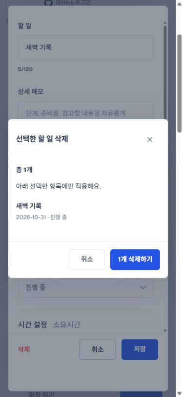
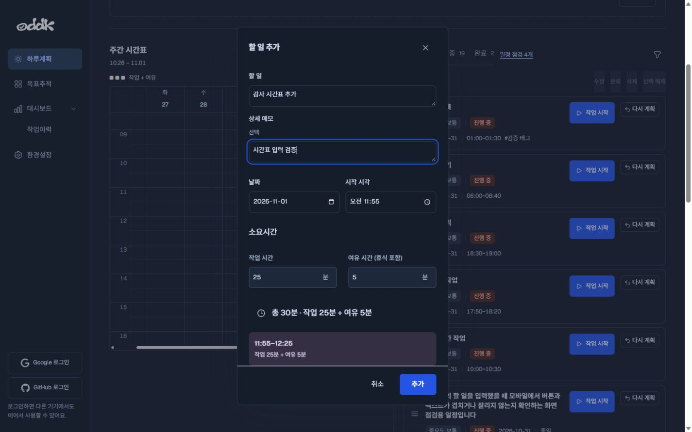
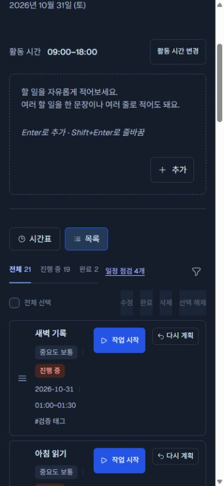
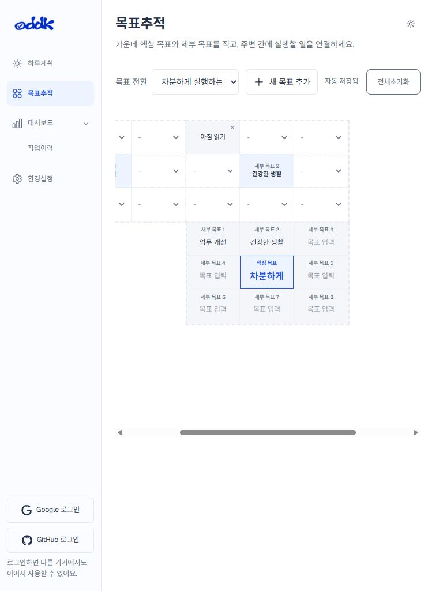
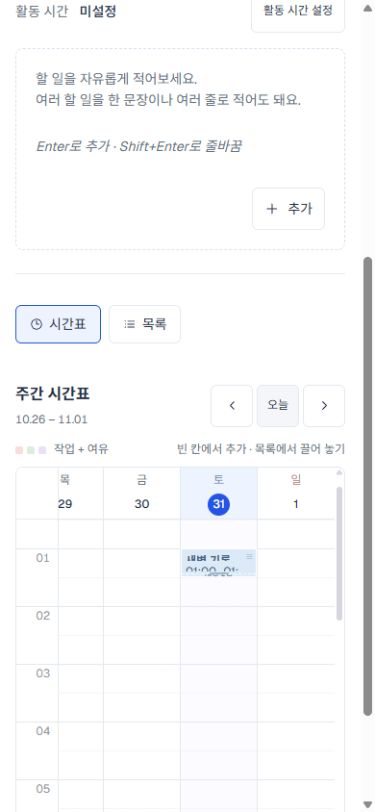
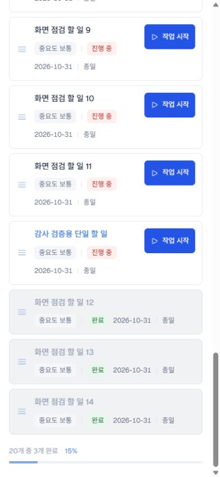
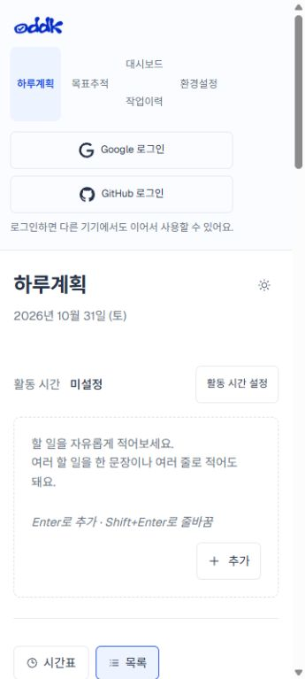
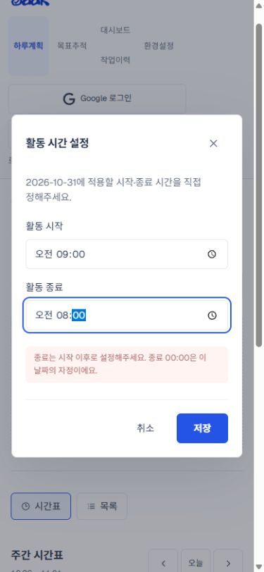

# UI 검사 결과 · 2026-11-01

삭제 확인창 디자인은 수정했습니다. 아래 추가 개선 6건은 발견·기록만 했으며 구현하지 않았습니다.

## 검사 기준

- 공개 수정 기준: `b7db4c6` 이후 확인창 관련 2개 파일.
- 감사 대상: 최신 로컬 소스의 고정 사본을 별도 프로덕션 빌드. 초기 시험 데이터 19개 할 일과 2개 목표 그룹.
- 기본 크기: 360×800, 390×844, 768×1024, 1024×768, 1440×900, 1920×1080. 보강: 320×568, 844×390.
- 주요4화면 × 기본6크기 24개 조합, 팝업/긴 목록/빈 상태/테마/기능 전환 추가 검사.
- 브라우저 캡처 72개 중 68개 사용, 전환 중 캡처 4개 제외. Android 설치 앱 화면 6개는 별도 기록.
- ‘통과’는 해당 행에 적힌 시나리오·입력 경로의 결과이며, OS 전체 인증이나 모든 기능 조합을 보장하지 않습니다.

## 이번에 수정한 내용

- 수정 팝업과 삭제 확인창의 PC 너비 600px, 제목 16px, 버튼 높이 44px, 공통 헤더·여백·하단 구분선을 일치시켰습니다.
- 본문만 스크롤되어 19개 대상/긴 제목/844×390 화면에서도 취소·확정 버튼이 유지됩니다.
- 모바일, 다크 테마, Tab/Escape·취소, 실제 삭제 반영을 검사했습니다.

## 추가 수정 후보 · 모두 미적용

| ID | 우선순위 | 항목 | 기기/상태 |
| --- | --- | --- | --- |
| F1 | P1 | 화면 폭 변경 시 시간표 추가 팝업이 사라짐 | PC → 모바일/태블릿의 목록 보기 |
| F2 | P2 | 핵심 목표 문장이 잘려 보임 | PC·태블릿·모바일 |
| F3 | P2 | 짧은 시간표 카드의 제목·시각 가독성 저하 | PC·모바일 시간표 |
| F4 | P2 | 긴 목록 하단에서 선택한 뒤 작업 버튼을 찾기 어려움 | 모바일 긴 할 일 목록 |
| F5 | P3 | 모바일 첫 화면에서 실제 할 일 목록이 보이지 않음 | 360×800·390×844, 로그인 전/Android 설치 앱 |
| F6 | P3 | 비활성 저장 버튼의 시각적 구분 부족 | 활동 시간 설정 |

### F1 · 화면 폭 변경 시 시간표 추가 팝업이 사라짐

1440px에서 시간표 빈 칸의 추가창을 연 뒤 390px로 줄이면, dialog는 :modal/open 상태지만 부모 aside가 display:none이 되어 창 크기가 0×0이 됩니다. 입력값은 남지만 추가·취소 버튼을 볼 수 없습니다. 시간표 탭 선택이나 폭 복원으로 다시 보입니다.

재현: PC 기본 목록 보기에서 시간표 빈 칸 클릭 → 제목/메모 입력 → 창 폭 390px로 변경.

권장 수정: 팝업을 숨겨지는 시간표 패널 밖의 공통 모달 영역으로 이동하고, 회전·폭 변경 중에도 입력과 취소 경로를 유지.

증거 캡처: 66-pc-dark-timetable-add, 67-mobile-dark-timetable-add

### F2 · 핵심 목표 문장이 잘려 보임

‘차분하게 실행하는 하루’가 전부 표시되지 않습니다. 390px에서 핵심 목표 입력칸 clientHeight=26px, scrollHeight=68px로 측정됐습니다. 768px와 1920px 화면에서도 끝부분이 잘립니다.

재현: 목표추적 → 핵심 목표에 해당 문장 입력 → 각 크기로 변경.

권장 수정: 셀 안의 핵심 목표 표시 높이·글자 크기를 조정하거나, 축약 상태와 전체 내용을 확인하는 경로를 명확하게 제공.

증거 캡처: 12-tablet-목표추적, 34-pc1920-목표추적

### F3 · 짧은 시간표 카드의 제목·시각 가독성 저하

30분 일정의 작업 영역이 25px인데 제목·시각 두 줄이 함께 들어갑니다. 모바일에서 각 글자 영역 높이가 약 7~8px로 줄고 시각의 일부가 잘립니다.

재현: 작업 25분+여유 5분인 일정을 배치 → 주간 시간표에서 확인.

권장 수정: 짧은 일정용 한 줄 표시와 상세 확인 방식을 두고, 실제 시간 축을 왜곡하지 않으면서 글자 영역을 확보.

증거 캡처: 53-mobile-timetable-stable

### F4 · 긴 목록 하단에서 선택한 뒤 작업 버튼을 찾기 어려움

20개 목록의 하단 항목을 선택했을 때 수정·완료·삭제 도구의 top이 -1666px였습니다. 선택한 행은 보이지만 도구는 화면 위로 멀리 벗어나 있습니다.

재현: 할 일 20개 준비 → 목록 맨 아래 항목 선택 → 선택한 위치에서 작업 도구 확인.

권장 수정: 선택 도구를 화면에 유지하거나 선택 행 근처에서 편집·완료·삭제로 이어지도록 구성.

증거 캡처: 40-mobile-selected-bottom

### F5 · 모바일 첫 화면에서 실제 할 일 목록이 보이지 않음

상단 탐색·로그인 영역과 큰 작성 영역이 첫 화면 대부분을 차지합니다. 360×800 첫 화면에는 목록 행이 보이지 않습니다. 데이터나 가로 배치가 깨진 문제와는 구분되는 사용성 개선 항목입니다.

재현: 로그인 전 상태로 하루계획 첫 진입 → 스크롤 전 화면 확인.

권장 수정: 모바일 탐색·계정 영역과 작성 영역을 압축하거나 접어 목록 접근 거리를 줄이는 안 검토.

증거 캡처: 25-android-size-하루계획, 15-ios-size-하루계획

### F6 · 비활성 저장 버튼의 시각적 구분 부족

09:00–08:00처럼 잘못된 범위를 넣으면 저장은 disabled이고 오류도 표시되지만, 버튼은 활성 상태와 비슷한 파란색으로 보입니다. 잘못된 저장은 실제로 차단됩니다.

재현: 활동 시간 설정 → 시작 09:00, 종료 08:00 입력 → 저장 버튼 상태 확인.

권장 수정: 비활성 기본 버튼에 명확한 색·명도·커서 상태를 적용하는 안 검토.

증거 캡처: 56-invalid-activity-hours

## 화면·기능별 검사표

| 단계 | 검사 | 환경 | 결과 | 근거 |
| --- | --- | --- | --- | --- |
| 01 | 랜딩 표시 | PC·390px | 통과 | 37,38 · 메인 문구, 예시 화면, 시작하기 표시; 문서 가로 넘침 없음 |
| 02 | 랜딩 진입·안내 링크 | 모바일 | 통과(범위 한정) | DOM · 시작하기 → 하루계획, 안내 링크 #how-it-works URL 변경 확인. 전환 중 안내 섹션 캡처는 제외 |
| 03 | 주요 4화면 탐색 | 6가지 기본 크기 | 통과·개선 별도 | 07–18,25–36 · 하루계획/목표추적/작업이력/환경설정 진입. 내용별 문제는 F1–F6 |
| 04 | 반응형 재배치 | 320/360/390/768/1024/1440/1920 및 844×390 | 확인 | 전체 · 캡처된 문서의 가로 넘침 없음. 시간표·목표판의 내부 가로 스크롤은 존재 |
| 05 | 단일 할 일 추가 | 390px | 통과 | 40,41,DOM · 추가 후 19→20개, 입력칸 초기화 |
| 06 | AI 다중 분리·검토 | 390px, 로컬 AI | 통과 | 59,60 · 두 행동 분리, 취소 시 원문 유지, 검토 수정 후 2개 추가, 빈 항목 저장 차단 |
| 07 | 할 일 수정·저장 | 390px | 통과 | 41 · 제목·메모·중요도·작업25분+여유5분 수정 후 재로딩 값 복원 |
| 08 | 태그 연결 | PC | 통과 | 65,DOM · 기존 태그를 할 일에 연결하고 저장 |
| 09 | 수정창 삭제 | 모바일 | 통과 | 01–06,DOM · 확인 취소 시 메모 초안 유지, 확정 시 목록·시간표 제거, 재로딩 유지 |
| 10 | 다중 삭제 확인 | 390px·844×390 | 통과 | 43,44 · 19개 대상·긴 제목 스크롤, 하단 버튼 유지. 실제 19개 삭제는 확정하지 않음 |
| 11 | 키보드·닫기 | 확인창 | 통과(기본) | 05,06,44 · Tab으로 확인 버튼 이동, Escape 취소, X/취소. 스크린리더 전수 검증은 제외 |
| 12 | 선택·완료·완료 취소 | 모바일 | 통과·개선 F4 | 40,45,78 · 선택 완료 후 완료 목록 반영, 완료 취소로 진행 중 복귀 |
| 13 | 목록 상태 필터 | 모바일 | 통과 | 45,78 · 전체/진행 중/완료 개수와 표시 확인 |
| 14 | 목록 정렬 | 320px | 통과 | 76 · 정렬 도구 표시, 시작시간 오름차순 적용 후 순서 확인 |
| 15 | 목록/시간표 전환 | 모바일·태블릿 | 통과·개선 F1 | 11,29,53,67 · 패널 전환 정상. 열린 일정 추가창과 폭 변경 조합은 실패 |
| 16 | 주 이동·날짜 선택·빈 화면 | 모바일 | 통과 | 53,77,DOM · 이전/다음 주, 오늘, 11월2일 빈 목록과 비활성 선택 도구 |
| 17 | 시간표 카드 수정 진입 | PC·모바일 | 통과 | 00,41,65 · 카드 클릭 → 해당 할 일 수정 |
| 18 | 시간표 날짜 이동 | 키보드 Alt+좌/우 | 통과(입력 경로 한정) | 54 · 10월31일→11월1일→복원; 작업·여유 유지. 포인터/터치 드래그는 미검증 |
| 19 | 시간표 소요시간 조절 | 키보드 위/아래 | 통과(입력 경로 한정) | DOM · 30→25→30분, 시작 시각·여유 유지. 터치 리사이즈는 미검증 |
| 20 | 시간표 빈 칸 추가 | PC | 통과·개선 F1 | 66,67,DOM · 11월1일 11:55–12:25 생성 후 해당 날짜 목록 확인. 작은 폭으로 변경하면 창 숨김 |
| 21 | 지난 일정 다시 계획 | PC | 통과 | 75 · 10월31일→11월1일, 시작 시각 해제·소요시간 유지·목록 반영 |
| 22 | 활동 시간 미설정·검증·저장 | 모바일 | 통과·개선 F6 | 56,57 · 빈 입력·역전 범위 저장 차단, 직접 09–18 저장, 다른 날짜 미설정 |
| 23 | 일정 경고 확인·닫기 | 모바일 | 통과 | 57,DOM · 범위 밖 4개, 목록4/시간표4 강조, X 후 재로딩에도 숨김 유지 |
| 24 | 작업 시작·정지·재개·휴식·종료 | 모바일 로컬 저장 | 통과 | 46,47 · 실제 타이머 상태와 작업/휴식 분리 기록 확인 |
| 25 | 작업이력 빈 상태·기록·저장 | 모바일·PC | 통과 | 09,13,47,63 · 종료한 기록의 작업19초/휴식6초 표시, 재로딩 후 다시 진입해 보존 확인 |
| 26 | 목표 문구·새 목표 자동 저장 | 모바일 | 통과·개선 F2 | 12,34,DOM · 새 목표/세부 목표 입력, 자동 저장, 재로딩 복원 |
| 27 | 목표에 할 일 연결·해제 | 모바일 | 통과 | DOM · 실행 슬롯 연결 후 수정 버튼 생성, 연결 해제 |
| 28 | 목표 초기화 취소·확정 | 모바일 | 통과 | 58 · 취소 시 유지, 새 목표만 초기화 후 다른 목표 보존 |
| 29 | 환경설정 4탭 | PC·태블릿·모바일 | 통과 | 10,14,18,48–51,68–74 · 일반/분류·태그/계정·동기화/알림·백업 표시 |
| 30 | 카테고리·태그 관리 | PC·모바일 | 통과(확인 범위) | 48,68,DOM · 카테고리·태그 추가, 카테고리 이름 수정·삭제, 할 일 보존 |
| 31 | 백업 다운로드 | PC Chrome·모바일 크기 | 통과 | 51,파일 · 실제 내려받은 JSON schemaVersion5·시험 task ID·19개 항목 확인. 다운로드 이벤트 대기는 도구에서 timeout이었으나 파일 실물 확인 |
| 32 | 로그인 안내·알림 진입 | 모바일 | 안내 화면 통과·연동 미검증 | 49–51 · 동기화 안내창과 계정 연결 필요 표시 확인. 새 로그인/푸시 권한/실제 수신 미검증 |
| 33 | 라이트/다크 테마 | 주요4화면·삭제 확인창 | 통과·기존 문제 별도 | 61–65 · 글자/배경/메뉴/버튼 표시, 확인창 테마 적용 |
| 34 | Android 설치 앱 | 에뮬레이터 | 부분 확인 | 19–24 native · 주요4화면·테마·입력 포커스·재진입 확인. 설치본 소스 SHA 불명, 검사 중 기기 연결 종료 |
| 35 | iOS Safari·실기기 | 환경 없음 | 미검증 | 없음 · 390px Chrome 화면 크기 결과를 iOS 실행 결과로 간주하지 않음 |
| 36 | 인증·동기화·알림·물리 입력 경계 | 장비/계정 조건 | 미검증 | 별도 명시 · 실계정 데이터 변경, OAuth 재로그인, 충돌, 푸시 수신, 실제 iOS 키보드/안전영역, 터치 드래그·회전 |

## 확인하지 못한 범위

- Windows Chrome에서 8가지 화면 크기를 검사했습니다. 실제 OS와 크기 검사는 구분합니다.
- Android 에뮬레이터의 설치 앱은 주요4화면과 테마/입력 포커스만 확인했습니다. 새 확인창이 포함된 APK 설치본의 소스 SHA는 확인하지 못했습니다.
- Android 설치 앱에서 로그인 연결 실패 안내가 한 번 보였으나 새로운 로그인은 실행하지 않아 원인/재현을 확정하지 않았습니다. 검사 도중 adb 연결이 종료되어 후속 네이티브 검사는 미완료입니다.
- iOS Safari/WebKit·실기기는 사용할 수 없어 미검증입니다. 390px Chrome 검사는 iOS 검증이 아닙니다.
- 포인터·터치 드래그, 전체 가상 키보드/회전/안전영역, 푸시 실제 수신, 실계정 충돌·오프라인 복구·로그인 재연결은 추가 확인이 필요합니다.
- 초기 시험 데이터는 19개 할 일/2개 목표 그룹이며 실제 사용자 데이터로 삭제·수정 검사를 하지 않았습니다.
- 로컬 최신 소스를 고정 복사한 별도 프로덕션 빌드로 검사했습니다. 공개 브랜치 b7db4c6 기반 수정과 로컬 native 관련 변경이 모두 동일 버전이라고 단정하지 않습니다.
- 전환 중 잘못된 상태를 담은 캡처 39/42/52/55는 시각 증거에서 제외했습니다.

## 코드 검사

ESLint·스타일 구조 검사·TypeScript·Node 테스트 336개·Pages 빌드·정적 내보내기 검사가 통과했습니다. 스크린리더·전체 명도 대비·실제 기기 인증까지 검증한 것으로 해석하지 않습니다.

## 증거 관리

선별한 익명 시험 화면은 이 문서의 assets에 있습니다. 전체 캡처·메트릭·순서별 설명은 로컬 `ui-audit-20261031/report.html`, `captures.json`, `audit-summary.json`에 보관했습니다. Android 설치 앱 캡처는 로컬에만 두었습니다.

